# 도메인별 역할 · 기능 · 흐름

tripleS 팬 커뮤니티를 **도메인(관심사)** 단위로 나눈 설명입니다.  
레이어 강제 여부는 [LAYER_ARCHITECTURE.md](./LAYER_ARCHITECTURE.md), 패키지·URL 전체는 [PROJECT_STRUCTURE.md](./PROJECT_STRUCTURE.md)를 참고하세요.

---

## 도메인 지도

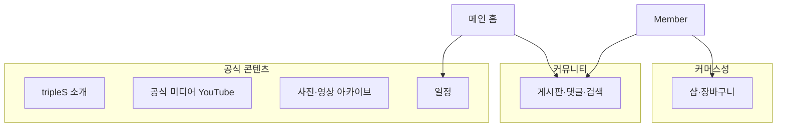

| 도메인 | 한 줄 역할 | 사용자에게 보이는 것 |
|--------|------------|----------------------|
| [회원·인증](#1-회원인증) | 계정·세션·권한 | 로그인, 가입, 마이페이지 |
| [게시판](#2-게시판-글댓글좋아요검색) | 팬 커뮤니티 글·소통 | 잡담/교환/거래/정보/공지, 댓글, 좋아요 |
| [tripleS 소개](#3-triples-소개-아티스트유닛앨범) | 그룹 메타 정보 조회 | 멤버·유닛·앨범·트랙 |
| [공식 미디어](#4-공식-미디어-youtube-카탈로그) | 공식 영상 큐레이션 | MV, SIGNAL, 비하인드 등 탭 |
| [아카이브](#5-파일-아카이브) | 유저/운영 업로드 미디어 보관 | 사진·영상 아카이브 |
| [일정](#6-일정) | 스케줄 캘린더 | 일정 목록·등록(ADMIN) |
| [샵](#7-샵) | 굿즈 소개·장바구니 | 카테고리별 상품, 카트 |
| [메인](#8-메인-홈) | 여러 도메인 요약 | 최근 글·인기글·일정 위젯 |
| [공통](#9-공통-인프라) | 파일·보안·시드 | uploads, Security, DataInitializer |

---

## 1. 회원·인증

### 역할

사이트 **신원(Identity)** 과 **권한(Authorization)** 을 담당한다.  
게시글 작성자 표시, ADMIN 전용 기능(공지·미디어 등록·샵 등록·일정 편집)의 전제 조건이다.

### 기능

| 기능 | 설명 |
|------|------|
| 회원가입 | ID/이메일 중복 검사, 비밀번호 해시, `ROLE_USER`·level·points 초기화 |
| 로그인 / 로그아웃 | Spring Security formLogin + 세션에 `loginMember`, `userId`, `role` |
| 마이페이지 조회·수정 | 이메일·주소 등 프로필 |
| 내 글 / 내 댓글 | 해당 userId로 작성 목록 (게시판·댓글 도메인 데이터 조회) |
| 레벨·포인트 | `Members.addPoints` — 포인트 구간으로 level 상승 (글 작성 등과 연동 가능) |

### 흐름

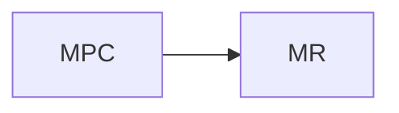

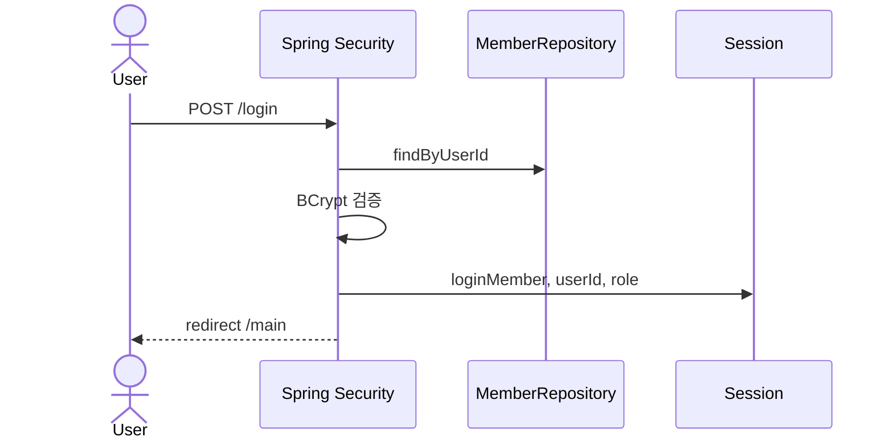

### 핵심 구성요소

| 종류 | 이름 |
|------|------|
| Entity | `Members` (`userId`, `password`, `email`, `address`, `role`, `level`, `points`) |
| Repository | `MemberRepository` |
| Controller | `LoginController`, `MyPageController` (+ `MyPost`/`MyComment`는 조회만) |
| 보안 | `SecurityConfig`, `CustomUserDetailsService`, `CustomAuthFailureHandler` |

### 레이어 메모

Service 없이 Controller → Repository. 가입·프로필은 규칙이 있어 [Should](./LAYER_ARCHITECTURE.md)로 `MemberService` 후보. 순수 조회·Security는 Repo 직접 허용.

---

## 2. 게시판 (글·댓글·좋아요·검색)

### 역할

팬이 **정보를 올리고 소통**하는 핵심 커뮤니티 도메인.  
카테고리별로 게시판을 나누고, 첨부·댓글·좋아요를 제공한다.

### 기능

| 기능 | 설명 |
|------|------|
| 글 CRUD | `/article/{category}` — 목록·작성·상세·수정·삭제 |
| 카테고리 | `chat`(잡담), `trade`(교환), `sell`(거래), `info`(정보), `notice`(공지, ADMIN), `free`(자유) |
| 첨부파일 | 업로드 API + 본문 HTML에서 미디어 추출해 `ArticleFile` 연결 |
| 댓글 | REST `/api/articles/{id}/comments` — 목록/작성/수정/삭제 |
| 좋아요 | 카테고리 제한(`free`, `chat`, `info`), 토글 시 `likesCount` 동기화 |
| 인기글 | 좋아요 수 기준 목록 (`/popular`, 메인 위젯) |
| 검색 | 제목·내용·작성자 부분 일치 (`/search`) |
| 내 글·내 댓글 | 마이페이지 연계 조회 |

### 흐름 (글 작성)

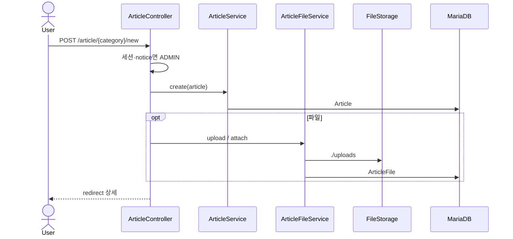

### 흐름 (구조)

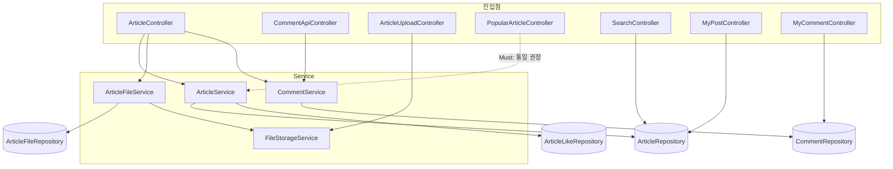

### 핵심 구성요소

| 종류 | 이름 |
|------|------|
| Entity | `Article`, `ArticleFile`, `ArticleLike`, `Comment` |
| Service | `ArticleService`(+Impl), `ArticleFileService`(+Impl), `CommentService`, `DateTimeFormatService` |
| Controller | `ArticleController`, `CommentApiController`, `ArticleUploadController`, `PopularArticleController`, `SearchController`, `MyPostController`, `MyCommentController` |
| 뷰 | `templates/article/*`, `templates/comment/*` |

### 레이어 메모

글·댓글·파일은 **정상 C→S→R**. Popular/Search/My* 는 Repo 직접 — Popular만 로직 불일치로 **Must** 정리 대상 ([레이어 가이드](./LAYER_ARCHITECTURE.md)).

---

## 3. tripleS 소개 (아티스트·유닛·앨범)

### 역할

그룹의 **공식 메타데이터 카탈로그** (멤버 프로필, 유닛 계층, 디스코그래피).  
커뮤니티 글과 분리된 **읽기 중심** 콘텐츠이다.

### 기능

| 기능 | 설명 |
|------|------|
| 아티스트 목록·상세 | 이름, 영문, 국적, 생일, 프로필 이미지, 대표 컬러 |
| 유닛 목록·상세 | 유닛명, 결성일, 상위/하위 유닛, 소속 멤버 |
| 앨범 목록·상세 | 앨범 정보, 트랙리스트(타이틀곡·러닝타임) |
| 시드 | 기동 시 앨범이 비어 있으면 `DataInitializer`가 대량 삽입 |

헤더의 `chemistry` 등은 템플릿/링크만 있고 백엔드가 비어 있을 수 있다.

### 흐름

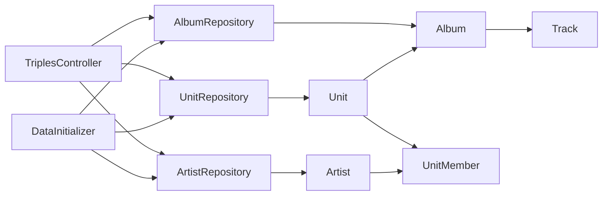

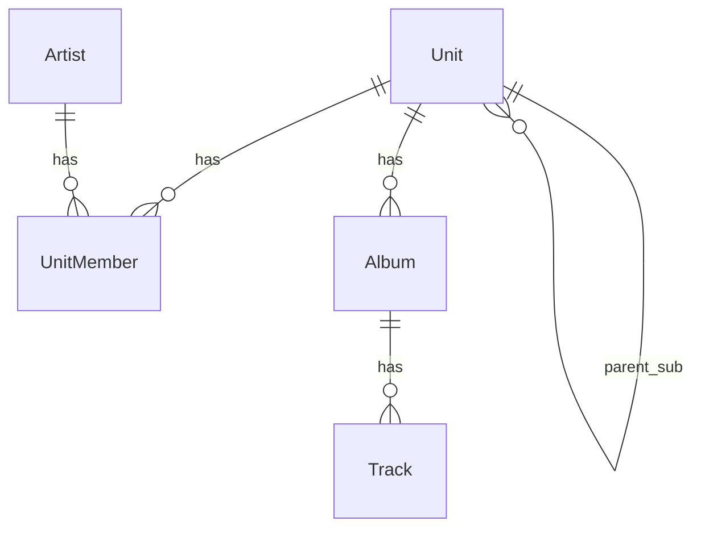

### 핵심 구성요소

| 종류 | 이름 |
|------|------|
| Entity | `Artist`, `Unit`, `UnitMember`, `Album`, `Track` |
| Repository | `ArtistRepository`, `UnitRepository`, `AlbumRepository` |
| Controller | `TriplesController` (`/triples/artist\|album\|unit`) |
| Config | `DataInitializer` |
| 뷰 | `templates/triples/*` |
| Util | `TrackInfo` (시드용 트랙 상수) |

### 레이어 메모

Service 없음 · Controller → Repository. **순수 조회라 Optional — 패턴 안 따라도 됨.**

---

## 4. 공식 미디어 (YouTube 카탈로그)

### 역할

공식 채널 영상을 **탭별로 큐레이션**해 보여 준다.  
DB Entity가 아니라 **JSON 파일 카탈로그** + YouTube API 메타데이터다.

### 기능

| 기능 | 설명 |
|------|------|
| 탭별 목록 | `mv`, `signal`, `behind`, `secret`, `contents` (`MediaTab`) |
| 상세 | `/media/{tab}/{youtubeId}` |
| 등록·삭제 | ADMIN — URL/ID 입력 후 API로 메타 조회 → JSON append/remove |
| Resolve API | `/api/media/resolve` — oEmbed / Data API로 미리보기 메타 |

### 흐름

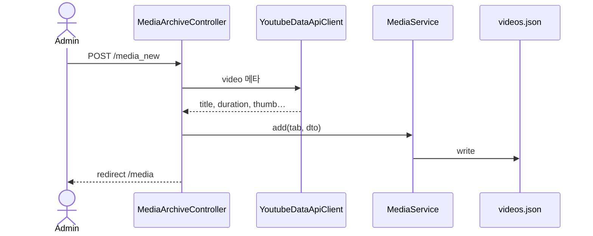

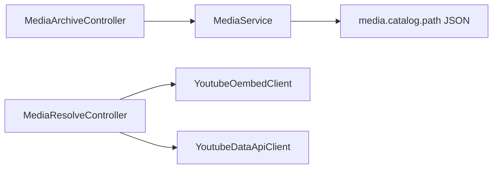

### 핵심 구성요소

| 종류 | 이름 |
|------|------|
| 저장 | `MediaService` → `media.catalog.path` (기본 `~/triplesWeb/data/videos.json`) |
| DTO | `MediaDto` |
| Infra | `YoutubeDataApiClient`, `YoutubeOembedClient`, `YoutubeIdExtractor`, `ISODuration` |
| Controller | `MediaArchiveController`, `MediaResolveController` |
| 뷰 | `archive/media*.mustache` |

### 레이어 메모

C → Service → JSON 은 정상(파일 백엔드). Resolve는 Infra 직접 호출 — Optional.

---

## 5. 파일 아카이브

### 역할

커뮤니티가 모은 **사진·영상 파일을 서버에 저장·열람**한다.  
공식 미디어(YouTube 링크)와 달리 **바이너리가 `uploads/`에 존재**한다.

### 기능

| 기능 | 설명 |
|------|------|
| 이미지/영상 목록 | `/archive/image_archive`, `/archive/video_archive` (페이징·검색) |
| 업로드 | 이미지·영상 전용 엔드포인트, `SavedMeta` + `MediaType` |
| 삭제 | ID 기준 삭제 (파일+DB) |

### 흐름

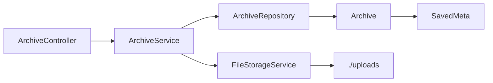

### 핵심 구성요소

| 종류 | 이름 |
|------|------|
| Entity | `Archive` + embed `SavedMeta`, enum `MediaType` |
| Service | `ArchiveService`, `FileStorageService` |
| Controller | `ArchiveController` |
| 뷰 | `templates/archive/image_archive`, `video_archive` |

### 레이어 메모

**정상 C→S→R→E.** 게시판 첨부(`ArticleFile`)와 저장소(`uploads`)는 공유하되 도메인 Entity는 분리.

---

## 6. 일정

### 역할

그룹·팬 관련 **스케줄을 캘린더에 표시**하고, ADMIN이 추가·수정·삭제한다.  
메인 홈에도 JSON으로 넘겨 위젯에 쓴다.

### 기능

| 기능 | 설명 |
|------|------|
| 목록·캘린더 | GET `/schedule` — FullCalendar용 JSON |
| 상세 | GET `/schedule/{id}` |
| 추가·수정·삭제 | ADMIN (`@PreAuthorize`) |

### 흐름

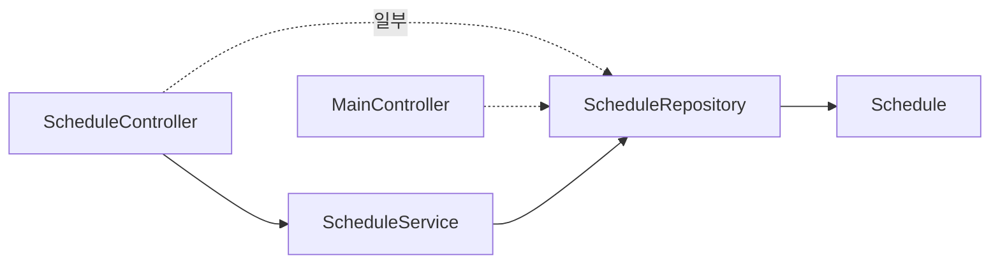

### 핵심 구성요소

| 종류 | 이름 |
|------|------|
| Entity | `Schedule` (`title`, `start`, `end`) |
| Service | `ScheduleService` |
| Controller | `ScheduleController`, (조회) `MainController` |
| DTO | `ScheduleForm` |
| 뷰 | `schedule.mustache` |

### 레이어 메모

대부분 Service. 상세·메인의 Repo 직접은 Optional — 모듈 내 스타일만 맞추면 충분.

---

## 7. 샵

### 역할

앨범·굿즈 등 **상품 소개와 세션 장바구니**.  
결제·주문 도메인은 없고, 카탈로그 + 카트 UI 수준이다.

### 기능

| 기능 | 설명 |
|------|------|
| 카테고리 목록 | `album`, `merch`, `photobook`, `magazine`, `tour` |
| 상세 | 이미지 슬라이드 |
| 상품 등록 | ADMIN — 이미지 다중 업로드 후 `Shop`+`ShopImage` |
| 장바구니 | 세션 `CART`에 ID 목록, 결제 없음 |
| 이미지 업로드 API | ADMIN `/shop/uploadFile` |

### 흐름

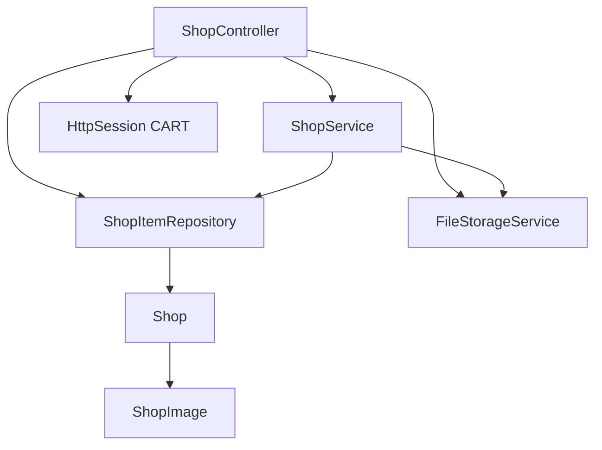

### 핵심 구성요소

| 종류 | 이름 |
|------|------|
| Entity | `Shop`, `ShopImage` (+ `SavedMeta`) |
| Service | `ShopService`, `FileStorageService` |
| Repository | `ShopItemRepository` |
| Util | `ShopCategory` |
| DTO | `ShopCardDto` |
| 뷰 | `templates/shop/*` |

### 레이어 메모

등록·카드 목록은 Service, 상세·카트는 Repo — Optional. 섞임만 정리하면 됨.

---

## 8. 메인 홈

### 역할

여러 도메인의 **요약 허브**. 자체 Entity는 없고, 게시판·일정을 모아 첫 화면을 만든다.

### 기능

| 기능 | 설명 |
|------|------|
| 최근 글 | `free` / `notice` 카테고리 일부 |
| 인기글 | `ArticleService.findPopularArticles` |
| 일정 위젯 | Schedule 목록 → JSON |
| 로그인 표시 | 세션의 level·points |

### 흐름

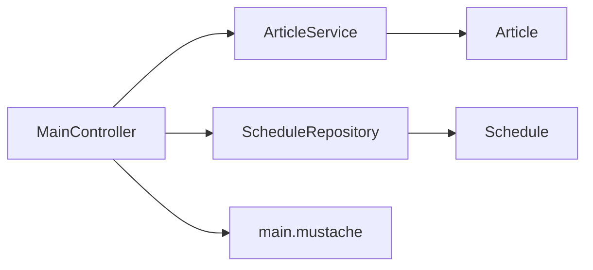

경로: `GET /main` (앱 진입 홈).

---

## 9. 공통 인프라

도메인은 아니지만 모든 업로드·보안의 기반이다.

| 구성요소 | 역할 |
|----------|------|
| `FileStorageService` | Multipart → `./uploads`, `SavedMeta` 생성 (썸네일 등) |
| `WebMvcConfig` | `/uploads/**` 정적 매핑 |
| `SecurityConfig` | URL별 permit / authenticated / ADMIN |
| `DataInitializer` | tripleS 메타 시드 |
| `GlobalUserInfo` / ModelAdvice | 템플릿 공통 로그인 정보·CSRF 토큰(설정상 CSRF는 비활성) |

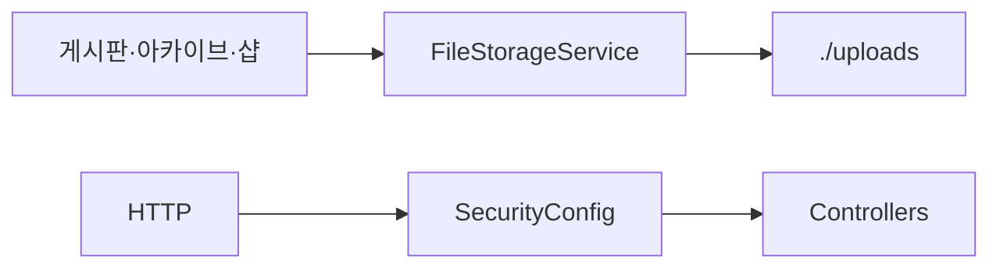

---

## 도메인 간 의존 (간단)

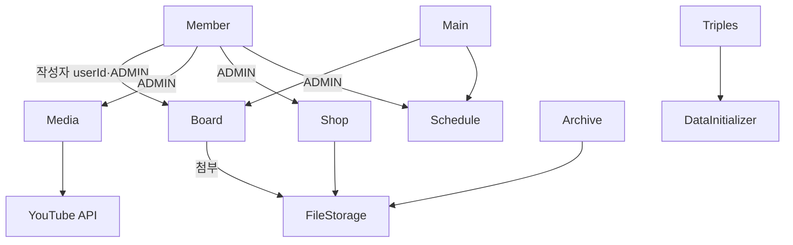

- **강한 결합**: 게시글·댓글의 `userId` 문자열 (Members와 FK가 아닐 수 있음 — 코드상 연관 컬럼)
- **권한 결합**: ADMIN 플래그는 Security role
- **저장소 공유**: `uploads/` 를 게시판·아카이브·샵이 공유

---

## 관련 문서

| 문서 | 내용 |
|------|------|
| [PROJECT_STRUCTURE.md](./PROJECT_STRUCTURE.md) | 패키지, URL, ERD, 시퀀스 |
| [LAYER_ARCHITECTURE.md](./LAYER_ARCHITECTURE.md) | C→S→R 권장 범위 (Must/Should/Optional) |
| [README.md](../README.md) | 진입 링크 |

*기준: 2026-10 소스 트리.*
