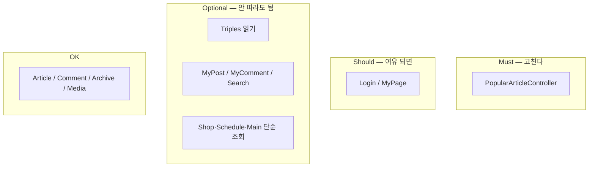

# 레이어 가이드 (Controller → Service → Repository → Entity)

Spring MVC에서 **Service 레이어는 강제가 아니라 권장(관례)** 입니다.  
MVC의 M은 “모델/데이터”이지 “반드시 `*Service` 클래스”가 아닙니다.

이 문서는 그 전제 아래:

1. **언제 Service를 두고, 언제 Controller → Repository로 충분한지** 기준을 정하고  
2. 현재 코드를 **Must / Should / Optional** 로 분류하며  
3. 꼭 손댈 곳만 해결 방안을 제시합니다.

개요·패키지 트리는 [PROJECT_STRUCTURE.md](./PROJECT_STRUCTURE.md) §3,  
도메인별 역할·흐름은 [DOMAINS.md](./DOMAINS.md)를 참고하세요.

---

## 1. 기본 입장

```text
권장:  Controller → Service → Repository → Entity
허용:  Controller → Repository → Entity     (조건이 맞을 때)
허용:  Controller → Infra / FileStorage      (영속 도메인이 아닐 때)
```

**패턴을 종교처럼 따르지 않는다.**  
대신 “규칙·중복·일관성”이 있는 곳에만 Service를 둔다.

같은 모듈 안에서는 스타일을 섞지 않는 것이 좋다.

- 이 모듈은 **전부 Service 경유**, 또는  
- 이 모듈은 **읽기라서 Repo 직접**  

둘 중 하나로 통일하면, “어떤 메서드만 Service?”로 인한 혼란이 줄어든다.

---

## 2. 판단 기준 (이 프로젝트 규칙)

### 2.1 Service를 두는 쪽 (권장 → 사실상 Must에 가까움)

| 조건 | 예 |
|------|-----|
| 쓰기 + 도메인 규칙 | 회원가입(중복·암호화·role), 프로필 수정 |
| 여러 Repository / 카운트 동기화 | 좋아요 = `Article` + `ArticleLike` |
| **같은 로직이 두 곳 이상** | 인기글·좋아요가 Popular와 Article에 각각 존재 |
| `@Transactional`이 필요한 변경 | 좋아요 토글, 상품 등록+이미지 |

### 2.2 Controller → Repository로 충분할 수 있는 쪽 (Optional)

| 조건 | 예 |
|------|-----|
| 읽기 한 방, 규칙 없음 | `findById`, `findAll` |
| 화면용 단순 목록 | 내 글/내 댓글 (userId + Sort만) |
| 팀원도 “여기엔 Service 없다”고 이해할 수 있음 | Triples 소개 페이지 |

### 2.3 레이어 밖·다른 계층 (위반으로 보지 않음)

| 위치 | 이유 |
|------|------|
| `SecurityConfig` / `UserDetailsService` | 보안 포트 — Repo 또는 얇은 조회 허용 |
| `DataInitializer` | 기동 시드 — Repo 직접 OK |
| `FileStorageService` | 파일 시스템 인프라 |
| `MediaService` → JSON | DB Repository가 없는 의도적 설계 |
| YouTube `infra` 클라이언트 | 외부 API |

---

## 3. 우선순위 정의

| 등급 | 의미 | 액션 |
|------|------|------|
| **Must** | 버그·동작 불일치·중복 구현 위험 | 가까운 시일 내 수정 |
| **Should** | 규칙은 있으나 당장 장애는 아님 | 여유 있을 때 Service로 모음 |
| **Optional** | 패턴만 보면 “우회”지만 **유지해도 됨** | 리팩터 강제하지 않음. 손대면 모듈 내 스타일만 통일 |
| **OK / N/A** | 권장 패턴을 따르거나, 해당 없음 | 유지 |

---

## 4. 현황 분류표

### 4.1 컨트롤러 한눈에

| Controller | 현재 형태 | 등급 | 한 줄 판단 |
|------------|-----------|------|------------|
| `ArticleController` | Service 경유 | **OK** | 기준 구현으로 유지 |
| `CommentApiController` | Service 경유 | **OK** | 유지 |
| `ArchiveController` | Service 경유 | **OK** | 유지 |
| `MediaArchiveController` | MediaService → JSON | **OK** | DB 없는 설계, 유지 |
| `PopularArticleController` | Repo 직접 + Article과 **로직 불일치** | **Must** | Service로 통일·like 중복 제거 |
| `LoginController` | Repo 직접 + Encoder `new` | **Should** | 가입 규칙은 Service 권장 |
| `MyPageController` | Repo 직접 (조회·저장) | **Should** | 프로필 수정 규칙 생기면 Service |
| `MainController` | 글=Service, 일정=Repo | **Optional**† | 일정은 `ScheduleService`로 맞춰도 되고, 일정만 Repo로 통일해도 됨 |
| `ScheduleController` | 대부분 Service, 상세만 Repo | **Optional**† | **섞인 것만** 정리 (전부 Service 또는 상세도 Service) |
| `ShopController` | 목록/등록=Service, 상세·카트=Repo | **Optional**† | 모듈 내 스타일 통일만 |
| `SearchController` | Repo 직접 | **Optional** | 단순 검색이면 유지 가능 |
| `MyPostController` | Repo 직접 | **Optional** | 유지 가능 |
| `MyCommentController` | Repo 직접 | **Optional** | 유지 가능 |
| `TriplesController` | Repo 직접 (순수 읽기) | **Optional** | **유지해도 됨** |
| `ArticleUploadController` | FileStorage만 | **OK** | 인프라. 게시글 첨부와 맞출 거면 ArticleFileService |
| `MediaResolveController` | Infra 직접 | **Optional** | 얇은 래핑 Service는 선택 |
| `ObjektController` | 스텁 | **N/A** | 구현 시 복잡도 보고 결정 |

† Optional이지만 “같은 클래스에서 Service와 Repo를 **메서드마다 섞는 것**”은 가독성만 해치므로, **스타일 통일**은 권장.



---

## 5. Must — 반드시 손댈 것

### 5.1 `PopularArticleController` (중복·불일치)

| 기능 | Popular 쪽 | Article 쪽 (`ArticleService`) |
|------|------------|-------------------------------|
| 인기글 | Repo: likesCount ≥ 5 | `findPopularArticles(...)` |
| 좋아요 | **추가만** (`already`) | `toggleLike` (**있으면 취소**) |
| URL | `POST /{category}/{id}/like` | `POST /article/{category}/{id}/like` |

문제의 본질은 “Service를 안 써서”가 아니라 **같은 도메인이 두 갈래**인 점이다.

**해결**

1. 목록 → `articleService.findPopularArticles(null, limit)`  
2. like API → **삭제**하거나 Article 엔드포인트/Service로 위임  
3. Controller는 인기글 **뷰 조립만** 담당

이게 이 문서에서 말하는 유일한 **Must** 리팩터다.

---

## 6. Should — 여유 있을 때

### 6.1 회원: `LoginController` / `MyPageController`

- 회원가입: 중복 ID·이메일, 비밀번호 해시, role/level 초기값 → **규칙이 있는 쓰기**
- `PasswordEncoder`를 `new BCryptPasswordEncoder()`로 쓰지 말고 **빈 주입**
- Spring Security formLogin과 커스텀 POST `/login` 이중 경로는 정리 검토

**제안**: `MemberService` (`signup`, `updateProfile`, `findByUserId`)  
지금 당장 장애는 아니므로 Should.

### 6.2 (선택 확장) 검색·내 글이 복잡해질 때

페이징·권한·전문검색이 생기면 그때 `ArticleService.search` / `findByAuthor`로 올리면 된다.  
**지금은 Optional 유지가 기본.**

---

## 7. Optional — 패턴을 안 따라도 되는 부분

아래는 “위반 목록에서 고치라”가 아니라 **현행 유지 가능**으로 본다.

| 대상 | 이유 | 손댄다면 |
|------|------|----------|
| `TriplesController` → Artist/Album/Unit Repo | 순수 읽기, Service 없음이 자연스러움 | 연관 fetch 정책이 복잡해지면 Query Service |
| `MyPost` / `MyComment` | userId 목록 조회만 | Article/Comment Service에 메서드 추가 |
| `SearchController` | 단순 Containing 검색 | 조건 늘면 Service |
| `Shop` 상세·카트 `findById` / `findAllById` | 규칙 없는 읽기 | ShopService에 두거나, Shop은 “읽기도 Repo”로 문서화하고 통일 |
| `Schedule` / `Main` 일정 `findAll` | Service에 동일 메서드 있음 | **섞임만** 없애기: 전부 Service **또는** 일정 조회는 전부 Repo |
| `MediaResolve` → Youtube clients | 외부 호출 프록시 | 테스트 격리 필요하면 얇은 Service |
| Security / DataInitializer / GlobalUserInfo | 웹 C→S→R 대상 아님 | 유지 |

### 7.1 “섞임”만 정리하는 요령 (Optional 안에서의 권장)

강제 리팩터가 아니라 **가독성**용이다.

**스케줄 예시 — 둘 중 하나**

- A) Controller는 `ScheduleService`만 사용 (상세도 `findById`)  
- B) 스케줄은 전부 Repo 직접, Service는 쓰지 않음  

지금은 A에 가깝게 이미 대부분이 Service이므로, 상세 한 곳만 Service로 맞추는 쪽이 비용이 적다.  
다만 이는 Must가 아니다.

---

## 8. 해결 방안 요약 (실행 계획)

### Phase Must (짧게)

1. Popular 목록 → `ArticleService`  
2. Popular like 중복 제거 / Article로 단일화  
3. (가능하면) 좋아요 허용 카테고리 등 규칙을 Article 한곳에만 둠  

### Phase Should (여유 시)

1. `MemberService` + Login/MyPage 이전  
2. `PasswordEncoder` DI  
3. 커스텀 로그인 경로와 Security formLogin 정리  

### Phase Optional (하지 않아도 됨)

- Triples / MyPost / MyComment / Search / Shop·Schedule 단순 조회는 **현행 유지**  
- 손댈 거면 “모듈 단위 스타일 통일”만  
- ArchUnit으로 “Controller → Repository 금지”를 **걸지 않는다** (이 프로젝트 정책과 충돌)

---

## 9. 목표 상태 (강제 범위만)

리팩터 “완료”의 정의를 좁힌다.

| 항목 | DoD |
|------|-----|
| Must | Popular와 Article의 인기글·좋아요 진입점이 **하나** |
| Should | 회원 가입·프로필이 `MemberService`(또는 동일 역할)에 모임 |
| Optional | 문서상 “유지 가능”으로 남는 직접 Repo 호출은 **허용** |
| 금지하지 않음 | 읽기 전용 Controller → Repository |

전체 Controller에서 Repository import 0건을 목표로 **하지 않는다.**

---

## 10. 빠른 참조 — 파일

| 등급 | 파일 |
|------|------|
| Must | `controller/PopularArticleController.java` ↔ `service/ArticleServiceImpl.java` |
| Should | `controller/LoginController.java`, `MyPageController.java` |
| Optional | `TriplesController`, `MyPostController`, `MyCommentController`, `SearchController`, `ShopController`(상세·카트), `ScheduleController`(상세), `MainController`(일정) |
| OK | `ArticleController`, `CommentApiController`, `ArchiveController`, `MediaArchiveController` |

---

## 11. 한 줄 요약

> **C→S→R→E는 권장이다. 규칙·중복·일관성이 있는 곳(지금 Must는 Popular)만 따르고, 순수 읽기·인프라·시드·보안은 안 따라도 된다. 같은 모듈에서만 스타일을 섞지 말자.**

*기준일: 2026-10-16 · 팀 합의에 따라 Must/Should 경계는 이 문서만 고치면 된다.*
