# tripleS Web — 프로젝트 구조 문서

인수인계용 개요입니다. 이 프로젝트는 **tripleS 팬 커뮤니티 웹사이트**이며, Spring Boot 기반 서버사이드 렌더링(SSR) 앱입니다.  
테스트 패키지명(`illitweb`), `data/illitdb.*` 파일 등으로 보아 **ILLIT 팬사이트에서 tripleS로 전환·포크된 코드**로 보입니다.

---

## 1. 한눈에 보는 스택


| 구분      | 기술                                                                |
| ------- | ----------------------------------------------------------------- |
| 언어 / 빌드 | Java 17, Gradle (Wrapper)                                         |
| 프레임워크   | Spring Boot **3.5.0**                                             |
| 웹       | Spring MVC + **Mustache** 템플릿                                     |
| 보안      | Spring Security (폼 로그인, BCrypt)                                   |
| 영속성     | Spring Data JPA + Hibernate                                       |
| DB      | **MariaDB** (`jdbc:mariadb://localhost:3306/triples`)             |
| 패키징     | `war` (`triples.war`) — 내장 Tomcat + 외부 WAS 배포 가능                  |
| 기타      | Lombok, Gson, Jackson JSR-310, Thumbnailator, Hibernate Validator |


로컬 실행 포트: **8080** (`application.properties`)

```bash
./gradlew bootRun
# 또는
./gradlew bootWar   # triples.war 생성
```

---

## 2. 디렉터리 트리

```
triplesweb/
├── build.gradle                 # 의존성·WAR 설정
├── settings.gradle              # rootProject.name = triplesweb
├── gradlew / gradle/            # Gradle Wrapper
├── data/                        # (레거시) H2 파일 DB 흔적 — 현재 설정은 MariaDB
│   ├── TriplesWebDb.mv.db
│   └── illitdb.mv.db
├── uploads/                     # 업로드 파일 저장 루트 (file.upload-dir)
│   ├── images/  videos/  files/  photos/  shop/
├── docs/
│   ├── PROJECT_STRUCTURE.md     # 이 문서
│   └── PROJECT_STRUCTURE.pdf    # PDF 버전
├── README.md
└── src/
    ├── main/
    │   ├── java/com/example/triplesweb/
    │   └── resources/
    │       ├── application.properties
    │       ├── static/          # css, js (Tailwind 설정 등)
    │       └── templates/       # Mustache 뷰
    └── test/java/com/example/illitweb/   # 패키지명 미정리 (구 ILLIT)
```

---

## 3. 패키지 구조와 레이어 흐름

이상적인 호출 방향은 아래와 같습니다.

```text
HTTP 요청
  → Controller   (라우팅 · 세션/권한 · 뷰/JSON 조립)
  → Service      (비즈니스 규칙 · 트랜잭션)
  → Repository   (JPA 쿼리)
  → Entity       (테이블 매핑)
```

실제 코드에서는 **Service를 거치지 않고 Controller → Repository** 로 가는 모듈이 있습니다(아래 §3.3).  
이는 MVC 강제가 아니라 **권장 패턴**이며, 순수 읽기 등은 허용할 수 있습니다.  
판단 기준·Must/Should/Optional: [LAYER_ARCHITECTURE.md](./LAYER_ARCHITECTURE.md)

### 3.1 레이어별 역할


| 레이어             | 패키지                | 역할                                                                                             | 하면 안 되는 일                         |
| --------------- | ------------------ | ---------------------------------------------------------------------------------------------- | --------------------------------- |
| **Controller**  | `controller/`      | URL 매핑, `HttpSession`/`Authentication` 검사, Model에 속성 넣고 Mustache 뷰명 반환 또는 `@ResponseBody` JSON | DB 쿼리 직접 작성(이상적으로), 복잡한 도메인 규칙 방치 |
| **Service**     | `service/`         | 도메인 로직, 여러 Repository 조합, 파일 저장·외부 API와 영속성 조율                                                 | HTTP/세션 의존을 깊게 끌어오기               |
| **Repository**  | `repository/`      | Spring Data JPA 인터페이스 — CRUD·파생쿼리·`@Query`                                                     | 비즈니스 분기                           |
| **Entity**      | `entity/`          | 테이블/연관관계 매핑 (`@Entity`, embed `SavedMeta`)                                                     | 웹 DTO 역할 겸하기(일부 코드는 혼재)           |
| **DTO**         | `dto/`             | 폼 바인딩(`*Form`), 화면/API 전송(`*Dto`), 매퍼                                                          | 영속 상태 관리                          |
| **Infra**       | `infra/`           | YouTube Data API / oEmbed HTTP 클라이언트                                                           | DB 접근                             |
| **View advice** | `view/`, 루트 Advice | CSRF·글로벌 모델 속성                                                                                 | —                                 |
| **Config**      | `config/`          | MVC 리소스, Mustache, Jackson, 시드(`DataInitializer`)                                              | —                                 |


### 3.2 패키지 디렉터리 트리 (주요 클래스)

```
com.example.triplesweb/
├── triplesWebApplication.java
├── SecurityConfig.java
├── CustomUserDetailsService.java      # UserDetailsService (SecurityConfig 인라인 Bean과 중복)
├── CustomAuthenticationProvider.java
├── CustomAuthFailureHandler.java
├── GlobalUserInfo.java                # MemberRepository 직접 사용
├── GlobalModelAttributeAdvice.java
│
├── controller/
│   ├── MainController.java            # 홈
│   ├── LoginController.java           # 로그인/회원가입
│   ├── MyPageController.java
│   ├── MyPostController.java
│   ├── MyCommentController.java
│   ├── ArticleController.java         # 게시판 CRUD
│   ├── ArticleUploadController.java   # 게시글 파일 업로드 API
│   ├── PopularArticleController.java
│   ├── CommentApiController.java      # 댓글 REST
│   ├── SearchController.java
│   ├── TriplesController.java         # 아티스트/앨범/유닛
│   ├── MediaArchiveController.java    # 공식 미디어(JSON)
│   ├── MediaResolveController.java    # YouTube 메타 resolve API
│   ├── ArchiveController.java         # 사진/영상 아카이브
│   ├── ScheduleController.java
│   ├── ShopController.java
│   └── ObjektController.java          # 스텁
│
├── service/
│   ├── ArticleService.java / ArticleServiceImpl.java
│   ├── ArticleFileService.java / ArticleFileServiceImpl.java
│   ├── CommentService.java
│   ├── FileStorageService.java / FileStorageServiceImpl.java
│   ├── ArchiveService.java
│   ├── MediaService.java              # videos.json R/W (DB 없음)
│   ├── ShopService.java
│   ├── ScheduleService.java
│   └── DateTimeFormatService.java
│
├── repository/
│   ├── MemberRepository.java          → Members
│   ├── ArticleRepository.java         → Article
│   ├── ArticleFileRepository.java     → ArticleFile
│   ├── ArticleLikeRepository.java     → ArticleLike
│   ├── CommentRepository.java         → Comment
│   ├── ArtistRepository.java          → Artist
│   ├── UnitRepository.java            → Unit
│   ├── AlbumRepository.java           → Album
│   ├── ArchiveRepository.java         → Archive
│   ├── ScheduleRepository.java        → Schedule
│   └── ShopItemRepository.java        → Shop
│
├── entity/
│   ├── Members, Article, ArticleFile, ArticleLike, Comment
│   ├── Artist, Unit, UnitMember, Album, Track
│   ├── Archive, Shop, ShopImage, Schedule
│   ├── SavedMeta (@Embeddable), MediaType (enum)
│
├── dto/          ArticleForm, ArticleViewDto, CommentDto, MemberForm, LoginForm,
│                 MediaDto, ArchiveForm, ScheduleForm, ShopCardDto, UploadResponse, …
├── config/       DataInitializer, WebMvcConfig, MustacheConfig, JacksonConfig, MediaTypeConverter
├── view/         CsrfModelAdvice, GlobalModelAdvice
├── infra/        YoutubeDataApiClient, YoutubeOembedClient
├── media/        MediaTab, FileStorageException
└── util/         YoutubeIdExtractor, ShopCategory, TrackInfo, HtmlMediaParser, ISODuration
```

### 3.3 모듈별 Controller → Service → Repository → Entity

범례: **정상** = Service 경유 · **[직접]** = Controller가 Repository(또는 Infra)를 직접 호출 · **혼합** = 둘 다 사용

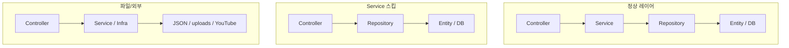


#### 요약 표


| 모듈          | Controller                 | Service                                                                                         | Repository                                                            | Entity / 저장소                            | 패턴                          |
| ----------- | -------------------------- | ----------------------------------------------------------------------------------------------- | --------------------------------------------------------------------- | --------------------------------------- | --------------------------- |
| 게시판         | `ArticleController`        | `ArticleService`(+Impl), `ArticleFileService`(+Impl), `CommentService`, `DateTimeFormatService` | `ArticleRepository`, `ArticleLikeRepository`, `ArticleFileRepository` | `Article`, `ArticleFile`, `ArticleLike` | **정상**                      |
| 댓글 API      | `CommentApiController`     | `CommentService`                                                                                | `CommentRepository`, `ArticleRepository`                              | `Comment`, `Article`                    | **정상**                      |
| 파일 업로드 API  | `ArticleUploadController`  | `FileStorageService`                                                                            | —                                                                     | `./uploads`                             | Service만 (DB 없음)            |
| 아카이브        | `ArchiveController`        | `ArchiveService` (+ `FileStorageService`)                                                       | `ArchiveRepository`                                                   | `Archive` (+ embed `SavedMeta`)         | **정상**                      |
| 공식 미디어      | `MediaArchiveController`   | `MediaService`                                                                                  | —                                                                     | `videos.json`                           | Service → JSON              |
| 미디어 resolve | `MediaResolveController`   | —                                                                                               | —                                                                     | YouTube (`infra`)                       | **[직접]** Controller → Infra |
| 샵           | `ShopController`           | `ShopService`, `FileStorageService`                                                             | `ShopItemRepository` **(Controller에서도 직접)**                           | `Shop`, `ShopImage`                     | **혼합**                      |
| 일정          | `ScheduleController`       | `ScheduleService`                                                                               | `ScheduleRepository` **(필드에 주입되나 목록은 Service 사용)**                    | `Schedule`                              | **혼합** (실질 Service 위주)      |
| 메인          | `MainController`           | `ArticleServiceImpl`                                                                            | `ScheduleRepository` **직접**                                           | `Article`, `Schedule`                   | **혼합**                      |
| tripleS 소개  | `TriplesController`        | —                                                                                               | `Artist`/`Album`/`Unit`Repository                                     | `Artist`, `Album`, `Unit`, `Track`…     | **[직접]**                    |
| 회원 로그인/가입   | `LoginController`          | —                                                                                               | `MemberRepository`                                                    | `Members`                               | **[직접]**                    |
| 마이페이지       | `MyPageController`         | —                                                                                               | `MemberRepository`                                                    | `Members`                               | **[직접]**                    |
| 내 글         | `MyPostController`         | —                                                                                               | `ArticleRepository`                                                   | `Article`                               | **[직접]**                    |
| 내 댓글        | `MyCommentController`      | —                                                                                               | `CommentRepository`                                                   | `Comment`                               | **[직접]**                    |
| 검색          | `SearchController`         | —                                                                                               | `ArticleRepository`                                                   | `Article`                               | **[직접]**                    |
| 인기글         | `PopularArticleController` | —                                                                                               | `ArticleRepository`, `ArticleLikeRepository`                          | `Article`, `ArticleLike`                | **[직접]**                    |
| 시드          | `DataInitializer` (config) | —                                                                                               | Artist/Album/Unit Repo                                                | Artist, Unit, Album, Track              | **[직접]**                    |
| 보안          | `SecurityConfig` 등         | —                                                                                               | `MemberRepository`                                                    | `Members`                               | **[직접]**                    |


#### 게시판 (정상 흐름)

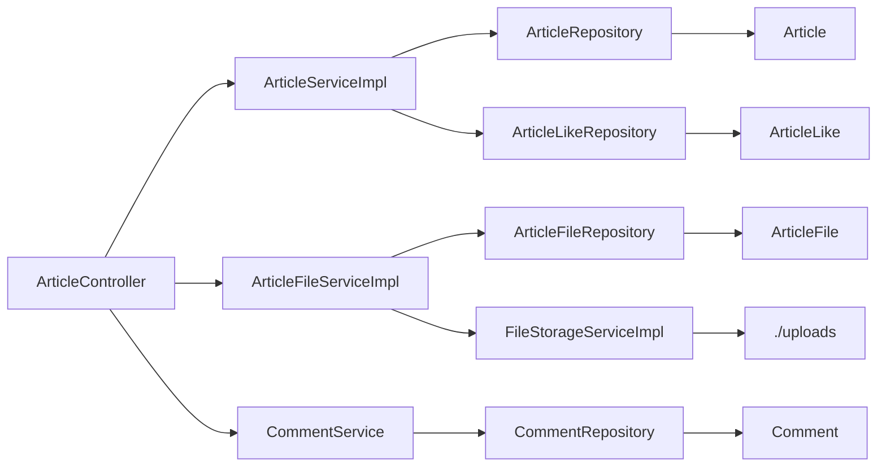


#### 회원 / 마이페이지 (Service 없음)

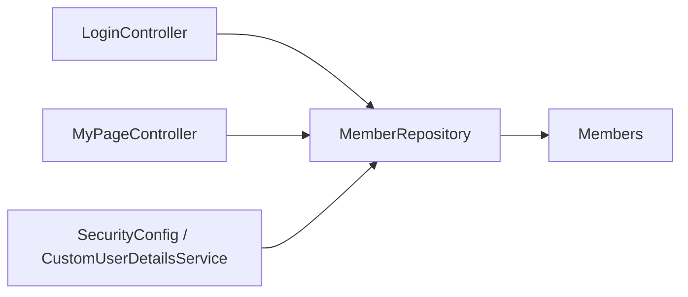


#### tripleS 소개 (Service 없음)

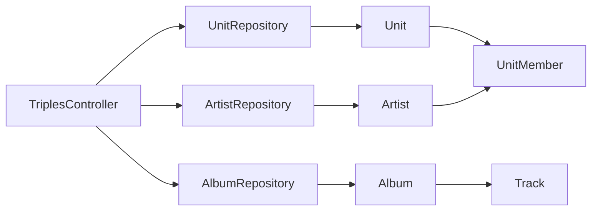


#### 공식 미디어 / 아카이브

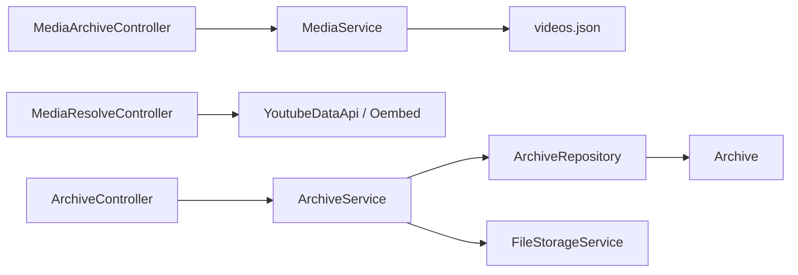


### 3.4 인수 시 레이어 관점 메모

1. **게시판·댓글·아카이브**는 Service 레이어가 갖춰져 있어 확장/테스트하기 비교적 수월합니다.
2. **회원·검색·인기글·내 글/댓글·Triples**는 Controller에 쿼리/매핑이 몰려 있어, 나중에 Service로 옮기면 중복(좋아요·카테고리명 등)을 줄일 수 있습니다.
3. **Shop / Schedule / Main**은 일부만 Service를 쓰고 Repository도 함께 주입하는 **혼합형**입니다.
4. **Media**는 DB Entity가 없고 JSON + YouTube Infra 조합입니다.

---

## 4. 도메인 모델 (기능 단위)

도메인별 **역할·기능·흐름·구성요소** 상세는 **[DOMAINS.md](./DOMAINS.md)** 에 정리했습니다.  
아래는 빠른 색인입니다.

| 도메인 | 역할 요약 | 상세 |
|--------|-----------|------|
| 회원·인증 | 계정, 세션, ADMIN 권한 | [§1](./DOMAINS.md#1-회원인증) |
| 게시판 | 글·댓글·좋아요·검색 | [§2](./DOMAINS.md#2-게시판-글댓글좋아요검색) |
| tripleS 소개 | 아티스트·유닛·앨범 조회 | [§3](./DOMAINS.md#3-triples-소개-아티스트유닛앨범) |
| 공식 미디어 | YouTube 탭 카탈로그(JSON) | [§4](./DOMAINS.md#4-공식-미디어-youtube-카탈로그) |
| 파일 아카이브 | 사진·영상 파일 보관 | [§5](./DOMAINS.md#5-파일-아카이브) |
| 일정 | 캘린더·ADMIN 편집 | [§6](./DOMAINS.md#6-일정) |
| 샵 | 상품 소개·세션 카트 | [§7](./DOMAINS.md#7-샵) |
| 메인 | 홈 위젯(글+일정) | [§8](./DOMAINS.md#8-메인-홈) |
| 공통 | 파일 저장·Security·시드 | [§9](./DOMAINS.md#9-공통-인프라) |

### 4.1 미구현·메뉴만 있는 경로

| 경로 | 상태 |
|------|------|
| `/objekt` | `ObjektController` 스텁 가능 |
| 헤더 `/cosmo/*`, `/sns` | 백엔드 미연결 가능 |
| `/triples/chemistry` | 템플릿·링크 불일치 가능 |

---

## 5. URL ↔ Controller 매핑 요약


| 경로 패턴                          | 컨트롤러                       | 설명                   |
| ------------------------------ | -------------------------- | -------------------- |
| `GET /main`                    | `MainController`           | 홈 (최근 글·인기글·일정 JSON) |
| `/login`, `/signup`, `/logout` | `LoginController`          | 인증                   |
| `/mypage`, `/mypage_edit`      | `MyPageController`         | 마이페이지                |
| `/myposts`, `/mycomments`      | `MyPost` / `MyComment`     | 내 글·댓글               |
| `/article/{category}/**`       | `ArticleController`        | 게시판 CRUD·좋아요         |
| `/popular`                     | `PopularArticleController` | 인기글                  |
| `/triples/**`                  | `TriplesController`        | 아티스트·앨범·유닛           |
| `/media`, `/media_new`, …      | `MediaArchiveController`   | 공식 미디어               |
| `/archive/**`                  | `ArchiveController`        | 사진/영상 아카이브           |
| `/schedule/**`                 | `ScheduleController`       | 일정                   |
| `/shop/**`                     | `ShopController`           | 샵                    |
| `/search`                      | `SearchController`         | 검색                   |
| `/api/articles/.../comments`   | `CommentApiController`     | 댓글 REST              |
| `/api/article/.../uploadFile`  | `ArticleUploadController`  | 게시글 파일 업로드           |
| `/api/media/resolve`           | `MediaResolveController`   | YouTube 메타 해석        |


정적 업로드 URL: `/uploads/**` → 프로젝트 루트 `./uploads` (`WebMvcConfig`)

---

## 6. 뷰 (Mustache) 구조

```
templates/
├── layout/header.mustache, footer.mustache
├── main.mustache
├── schedule.mustache, search.mustache
├── members/     login, signup, mypage, mypage_edit, myposts, mycomments
├── article/     article, article_new, article_edit, article_detail, popular
├── comment/     부분 템플릿 (_list, _comments, _new)
├── triples/     artist, album, unit, *_detail, chemistry
├── archive/     image/video archive, media*, media_detail
└── shop/        shop, shop_detail, shop_new, shop_cart
```

프론트: Tailwind (`static/js/tailwind.config.js`) + `static/css/style.css`.  
헤더 브랜딩 컬러 톤: dark + cyan accent (`#00f5d4`).

---

## 7. 설정 (`application.properties`) 핵심


| 키                                      | 의미                  |
| -------------------------------------- | ------------------- |
| `spring.datasource.*`                  | MariaDB 접속          |
| `spring.jpa.hibernate.ddl-auto=update` | 스키마 자동 갱신           |
| `file.upload-dir=./uploads`            | 업로드 루트              |
| `media.catalog.path`                   | YouTube 미디어 JSON 경로 |
| `youtube.api.key`                      | YouTube Data API 키  |
| multipart max                          | 파일 1GB / 요청 10GB    |


> **보안 주의**: DB 비밀번호·YouTube API 키가 properties에 **평문**으로 들어 있습니다.  
> 인수 후 즉시 키 로테이션·환경변수/`application-local.properties`(gitignore)로 분리하는 것을 권장합니다. 이 문서에는 실제 값을 적지 않습니다.

---

## 8. 데이터 흐름 예시

### 게시글 작성

```
브라우저 POST /article/{category}/new
  → ArticleController (세션 userId, notice면 ADMIN 체크)
  → ArticleServiceImpl 저장
  → (선택) ArticleFileService / FileStorageService → ./uploads
  → redirect /article/{category}/{id}
```

### 공식 미디어 등록 (ADMIN)

```
POST /media_new
  → MediaArchiveController
  → Youtube API로 메타 조회
  → MediaService가 videos.json에 탭별 목록 append
```

### 기동 시 시드

```
Spring Boot start
  → DataInitializer.run()
  → album 테이블이 비어 있으면 Artist / Unit / Album / Track 삽입
```

---

## 9. 서비스·리포지토리 대응표

모듈별 전체 호출 체인(Controller 포함, Service 스킵 여부)은 **§3.3**을 보세요. 아래는 Service → 하위 의존성만 정리합니다.


| Service                       | 주요 Repository / 외부                            |
| ----------------------------- | --------------------------------------------- |
| `ArticleService` / `Impl`     | `ArticleRepository`, `ArticleLikeRepository`  |
| `ArticleFileService` / `Impl` | `ArticleFileRepository`, `FileStorageService` |
| `CommentService`              | `CommentRepository`, `ArticleRepository`      |
| `FileStorageService` / `Impl` | 로컬 디스크 (`uploads/`)                           |
| `ArchiveService`              | `ArchiveRepository`, `FileStorageService`     |
| `MediaService`                | JSON 파일 (`media.catalog.path`)                |
| `ShopService`                 | `ShopItemRepository`, `FileStorageService`    |
| `ScheduleService`             | `ScheduleRepository`                          |
| `DateTimeFormatService`       | 포맷 유틸 (Repository 없음)                         |


리포지토리 목록:  
`Member`, `Article`, `ArticleFile`, `ArticleLike`, `Comment`, `Artist`, `Unit`, `Album`, `Archive`, `Schedule`, `ShopItem`

---

## 10. 알려진 미정리 / 주의점 (인수 시 체크리스트)

1. **패키지·이름 잔재**: 테스트 `com.example.illitweb`, `data/illitdb.`* — ILLIT 포크 흔적
2. **UserDetailsService 이중 정의**: `SecurityConfig` 인라인 Bean + `CustomUserDetailsService` 클래스
3. **헤더 메뉴 vs 실제 라우트**: `/cosmo/`*, `/sns`, `/triples/chemistry` 등 UI만 있고 백엔드 미구현 가능
4. **메인 카테고리 불일치**: 헤더는 `chat` 등, 메인 위젯은 `free`/`notice` 중심
5. **CSRF disable** + 대용량 업로드 허용 — 운영 전 보안 재검토 필요
6. **시크릿 평문** — DB/API 키 분리·로테이션
7. **H2 파일(`data/`)과 MariaDB 혼재** — 현재 활성 설정은 MariaDB; `data/`는 과거 실험물일 가능성
8. `build/` 산출물·`.class`가 워킹트리에 보일 수 있음 — 보통 gitignore 대상

---

## 11. 로컬 개발 빠른 시작

1. MariaDB에 DB `triples` 생성, `application.properties`의 접속 정보 맞추기
2. (선택) YouTube API 키 설정, `media.catalog.path` 디렉터리 준비
3. `./gradlew bootRun`
4. 브라우저 `http://localhost:8080/main`
5. 최초 기동 시 `DataInitializer`가 아티스트/앨범 시드 삽입 (앨범이 이미 있으면 스킵)

관리자 기능(미디어 등록, 샵 상품 등록, 공지 작성)은 `Members.role = ROLE_ADMIN` 계정 필요.

---

## 12. 모듈 의존 관계 (개념도)

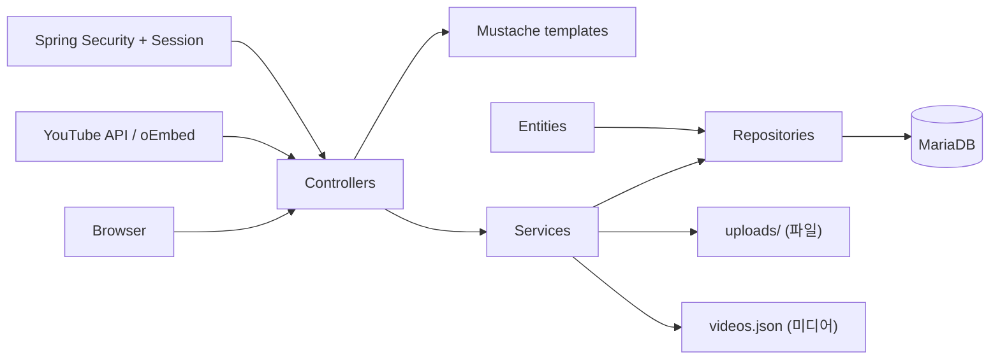


외부: YouTube Data API / oEmbed (`infra`)  
보안: Spring Security + `HttpSession(loginMember)`

---

## 13. ERD (핵심 엔티티)

JPA 매핑 기준으로 관계를 단순화한 다이어그램입니다. embed 타입 `SavedMeta`는 별도 테이블이 아닙니다.

### 13.1 회원 · 게시판

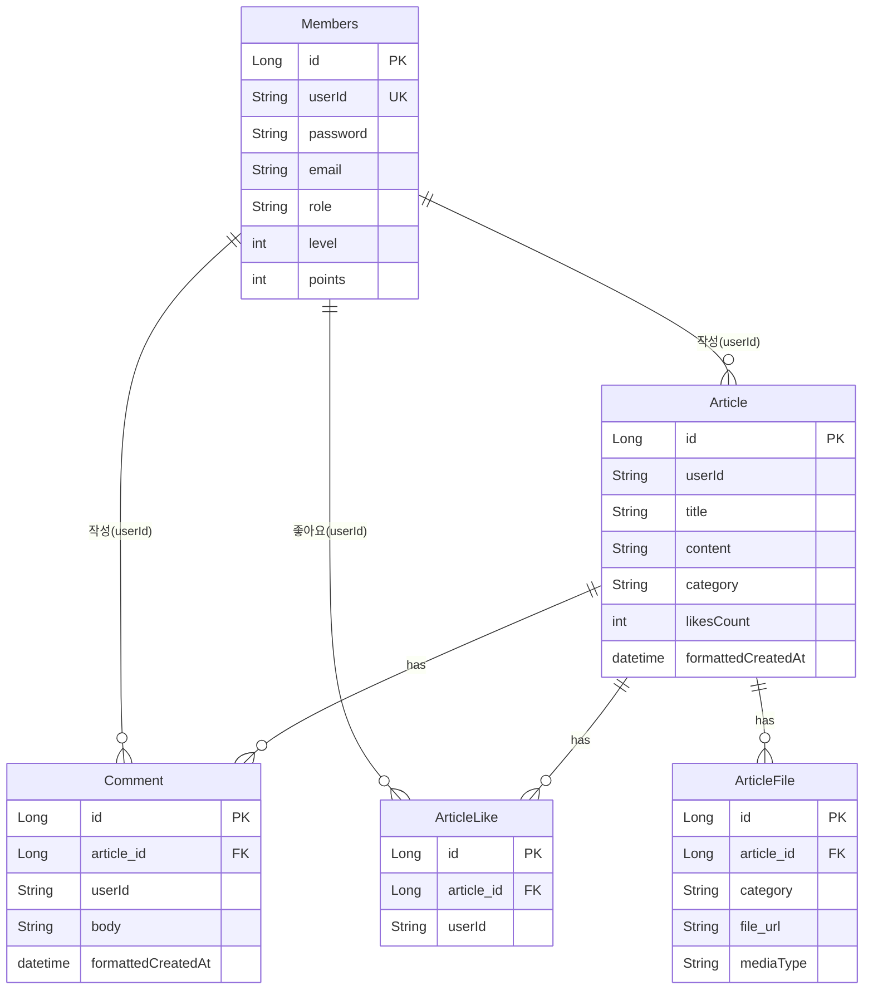


### 13.2 아티스트 · 유닛 · 앨범

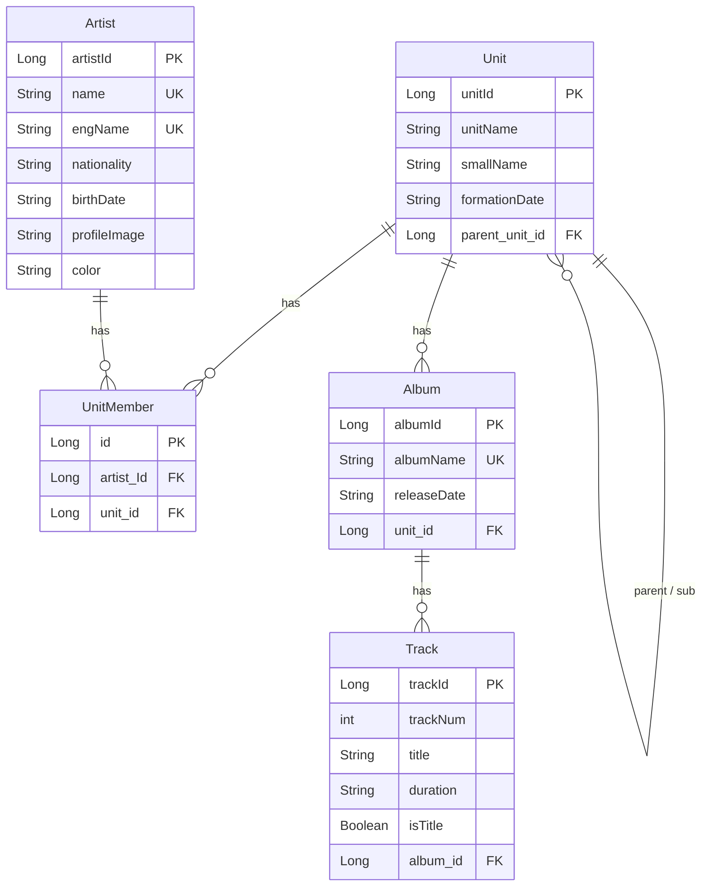


### 13.3 샵 · 아카이브 · 일정

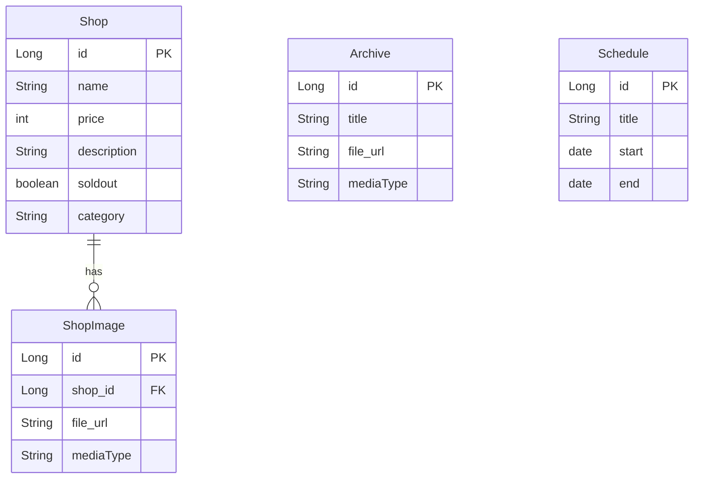


> **참고**: 공식 미디어(`/media`) 목록은 DB가 아니라 `media.catalog.path` JSON 파일에 저장됩니다.

---

## 14. 시퀀스 다이어그램

### 14.1 로그인

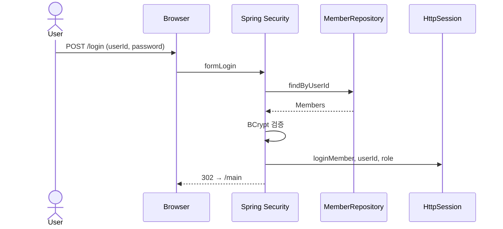


### 14.2 게시글 작성

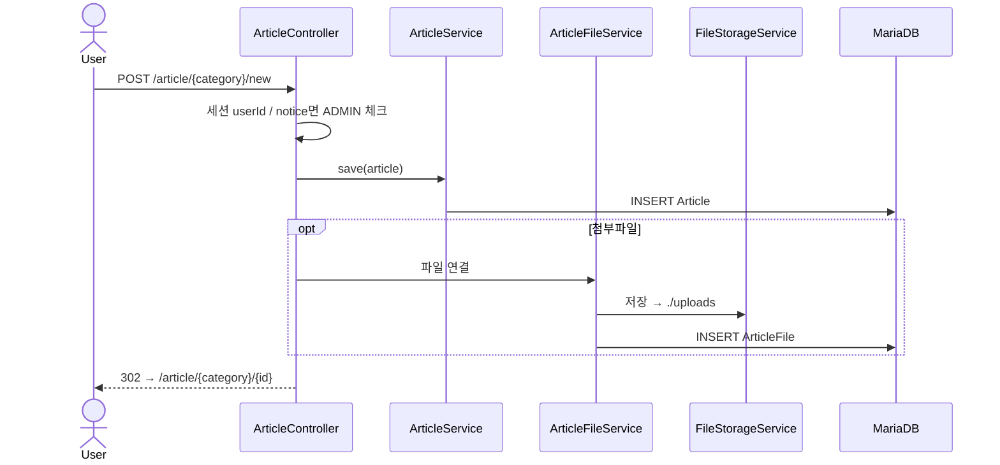


### 14.3 공식 미디어 등록 (ADMIN)

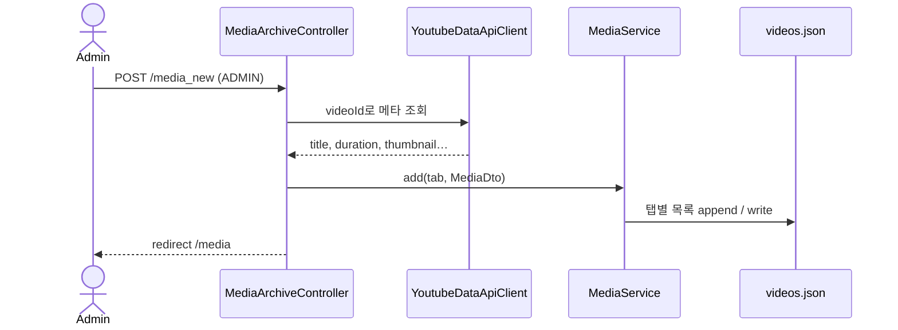


### 14.4 댓글 API

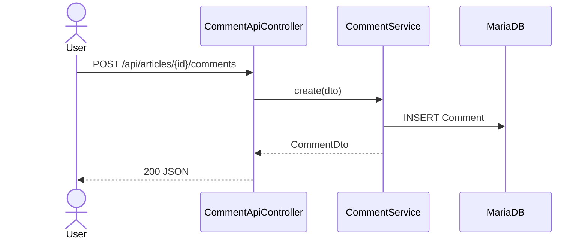


---

*문서 작성 기준: 저장소 소스 트리 기준 스냅샷. 세부 비즈니스 규칙은 각 Controller/Service 소스를 우선하세요.*